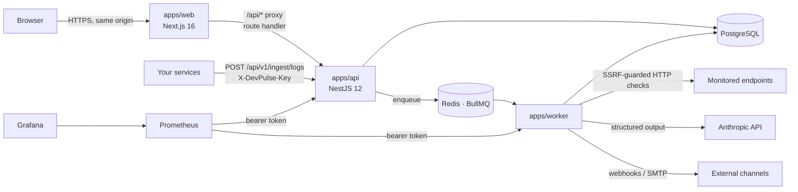

# Architecture

DevPulse AI is a pnpm monorepo with three deployables (web, API, worker) and four internal packages.
Everything is TypeScript (strict), ESM, Node.js 22.



## Components

| Component           | Responsibility                               | Notes                                                                                                                                                                                                                                                                                                                                                                                    |
| ------------------- | -------------------------------------------- | ---------------------------------------------------------------------------------------------------------------------------------------------------------------------------------------------------------------------------------------------------------------------------------------------------------------------------------------------------------------------------------------- |
| `apps/web`          | UI: landing, auth, product pages             | Next.js App Router, Tailwind 4, Radix-based components in shadcn style, TanStack Query, React Hook Form + zod, Recharts. A route handler (`src/app/api/[...path]/route.ts`) proxies `/api/*` to the API at request time, so cookies are first-party and the API needs no public CORS. `src/proxy.ts` redirects requests without a session cookie (optimistic; the API is the authority). |
| `apps/api`          | REST API, auth, RBAC, validation, enqueueing | NestJS with a single module (thin controllers per feature folder). Guards run in a fixed order: rate limit → CSRF origin check → session → tenant/permission. zod validates every body and query at the controller boundary. Swagger at `/api/docs` outside production.                                                                                                                  |
| `apps/worker`       | Background processing                        | BullMQ consumers: monitor checks, AI analyses, notification delivery, maintenance (retention, error-spike scan). Exposes `/health` and Prometheus `/metrics`. Never serves user traffic.                                                                                                                                                                                                 |
| `packages/database` | Prisma schema, migrations, client factory    | Prisma 7 with the `pg` driver adapter. Also hosts the notification fan-out helper shared by API and worker.                                                                                                                                                                                                                                                                              |
| `packages/shared`   | Pure domain logic + zod schemas              | Monitor state machine, incident workflow, RBAC matrix, uptime/percentile maths, redaction, log fingerprinting. `@devpulse/shared/node` adds SSRF guard, safe HTTP client and crypto helpers. Used by web, API and worker.                                                                                                                                                                |
| `packages/ai`       | LLM integration layer                        | Provider interface, Anthropic provider, versioned prompts, context builder, response validator, pricing. No database access.                                                                                                                                                                                                                                                             |
| `packages/queue`    | Queue contract                               | Queue names, job payload types, and a factory that selects the backend (Redis or BullMQ's PostgreSQL adapter).                                                                                                                                                                                                                                                                           |

## Key flows

### Monitor check

1. Creating or updating a monitor upserts a BullMQ **job scheduler** (`monitor:<id>`, `every: interval`). The worker reconciles schedulers with the database on start-up, which repairs a flushed Redis.
2. The worker runs the HTTP request **outside** any transaction through `safeHttpRequest` (scheme/host checks, DNS resolution validated at connect time, manual redirects re-validated per hop, bounded body, timeout).
3. A short transaction locks the monitor row (`SELECT … FOR UPDATE`), inserts the check (unique `idempotencyKey` = job id, so retries cannot double-record), applies the pure state machine (`applyCheck`) and performs the resulting action:
   - threshold reached → create incident (unique `activeMonitorId` guarantees one open automatic incident per monitor), link the failing streak, notify;
   - recovery → resolve incident, notify;
   - first latency breach → notify.
4. External deliveries are enqueued after commit.

### AI analysis

1. API validates the target belongs to the tenant, checks configuration and budget, dedupes in-flight requests, stores `AIAnalysis(PENDING)` and enqueues.
2. Worker re-checks the budget (authoritative), builds a **bounded, redacted** context (≤ 30 checks, ≤ 25 log lines, ≤ 24 000 chars; logs wrapped in `<untrusted_data>`), calls the provider with schema-constrained output, then validates locally: evidence ids must exist, unsupported "confirmed" causes are downgraded, claims of having acted are flagged.
3. Result, model, prompt version, token usage and cost are stored. Failures that consumed tokens are still billed in `UsageRecord`. Retryable failures use BullMQ exponential backoff; the final attempt marks `FAILED` with no result.

### Log ingestion

`POST /api/v1/ingest/logs` with an application-scoped key (only its SHA-256 is stored). Batches ≤ 100 events, message ≤ 8 KB, metadata ≤ 8 KB. Messages and metadata are redacted; ERROR/FATAL events are fingerprinted (numbers, ids, URLs, quoted strings removed) and upserted into `ErrorGroup` with a single atomic `INSERT … ON CONFLICT` so concurrent batches never lose counts.

## Cross-cutting concerns

- **Multi-tenancy**: every tenant-owned row has `organizationId`; every query filters by it. Routes are `/orgs/:orgId/...`; `OrgAccessGuard` returns **404** for non-members so other tenants' ids are not disclosed.
- **Observability**: pino structured logs with request ids (credentials redacted), Prometheus metrics (HTTP latency histogram by route template, checks by result, jobs by outcome, AI spend, incidents), health/readiness endpoints, Grafana dashboard provisioned.
- **Resilience**: worker `error` events are always handled, graceful shutdown waits for in-flight jobs, memory limit in compose, retries with backoff for AI and webhooks, `UnrecoverableError` for configuration problems.
- **Queue backend**: Redis in production. `QUEUE_BACKEND=postgres` uses BullMQ's official PostgreSQL adapter for environments without Redis (used to develop and test this project locally); application code is identical.

## Repository layout

```text
apps/      api · worker · web
packages/  ai · database · queue · shared
infrastructure/  docker/Dockerfile · prometheus/ · grafana/
tests/     e2e/ (Playwright) · fixtures/ (controllable target service)
docs/      this documentation
scripts/   dev-infra.mjs (Postgres/Redis without Docker) · svc.sh
```
