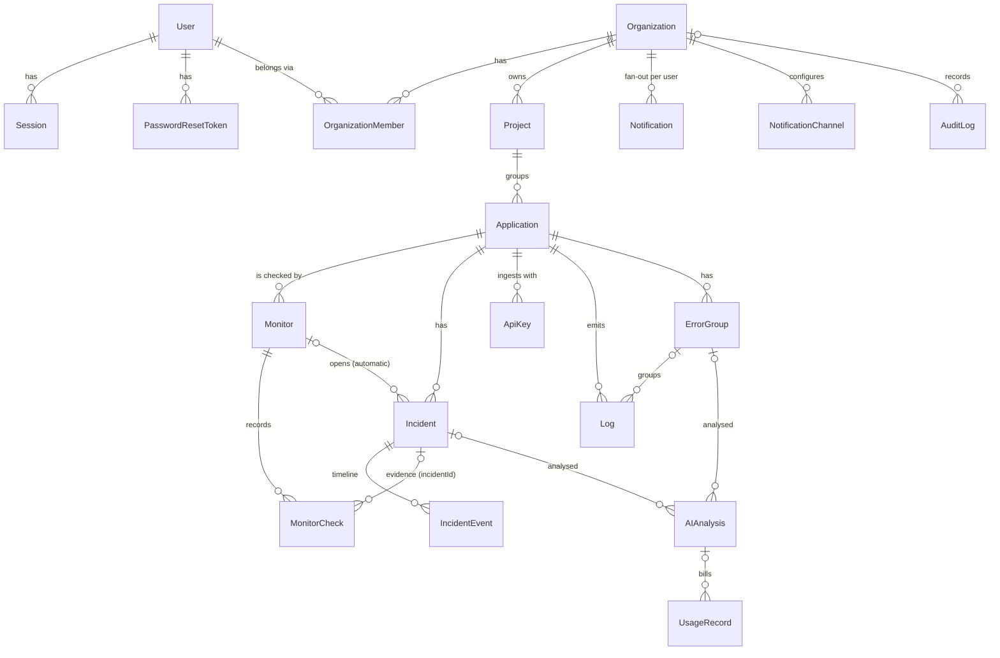

# Database

PostgreSQL (17+ recommended; tests run on 17 and 18) managed with Prisma 7. Schema: `packages/database/prisma/schema.prisma`. Migrations: `packages/database/prisma/migrations` (versioned, applied with `prisma migrate deploy`).

## ERD

## Entities

| Entity              | Purpose                                               | Notable constraints / indexes                                                                                                                                                   |
| ------------------- | ----------------------------------------------------- | ------------------------------------------------------------------------------------------------------------------------------------------------------------------------------- |
| User                | Account                                               | `email` unique (normalised lowercase). Argon2id hash.                                                                                                                           |
| Session             | Server-side session                                   | Only `sha256(token)` stored (`tokenHash` unique). Index on `expiresAt` for cleanup.                                                                                             |
| PasswordResetToken  | Single-use reset                                      | Hashed, 30 min TTL, `usedAt` set atomically.                                                                                                                                    |
| Organization        | Tenant                                                | `slug` unique. AI budget and retention policy live here.                                                                                                                        |
| OrganizationMember  | Membership + role                                     | Unique `(organizationId, userId)`. Role enum OWNER/ADMIN/MEMBER/VIEWER.                                                                                                         |
| Project             | Groups applications                                   | Unique `(organizationId, name)`. Delete is **restricted** while it has applications.                                                                                            |
| Application         | Monitored service                                     | Unique `(organizationId, name)`. `environment` drives outage severity.                                                                                                          |
| Monitor             | HTTP check configuration + live state                 | Index `(organizationId, status)`. `expectedStatusCodes` is an `int[]` (bounded list of scalars, not a JSON blob).                                                               |
| MonitorCheck        | One check result                                      | `idempotencyKey` unique (job id → retried jobs cannot double-record). Index `(monitorId, checkedAt DESC)`.                                                                      |
| Incident            | Outage or declared problem                            | `activeMonitorId` **unique**: set while unresolved → at most one open automatic incident per monitor, enforced by the database even with concurrent workers.                    |
| IncidentEvent       | Timeline (status, assignment, comments, AI, recovery) | Index `(incidentId, createdAt)`. Comments are events of type COMMENT.                                                                                                           |
| ApiKey              | Ingestion credential per application                  | `keyHash` unique; plain key shown once.                                                                                                                                         |
| ErrorGroup          | Errors with the same message shape                    | Unique `(applicationId, fingerprint)`; atomic upsert maintains `count`, `severity` (max), first/last seen.                                                                      |
| Log                 | Ingested event                                        | Indexes `(organizationId, timestamp DESC)`, `(applicationId, timestamp DESC)`, **GIN trigram** on `message` for `ILIKE` search. `metadata` JSON is bounded (8 KB) and redacted. |
| AIAnalysis          | Analysis request + validated structured result        | `result` JSON is the schema-validated model output (justified: a versioned document, not relational data).                                                                      |
| UsageRecord         | Billing per provider call                             | `costUsd numeric(12,6)`. Index `(organizationId, createdAt)` for monthly budget sums.                                                                                           |
| Notification        | In-app notification per user                          | Index `(userId, organizationId, readAt, createdAt)`.                                                                                                                            |
| NotificationChannel | E-mail / webhook target                               | `events` is an enum array.                                                                                                                                                      |
| AuditLog            | Security trail                                        | Redacted `details`.                                                                                                                                                             |

All primary keys are UUID v7 (time-ordered → index locality, and cursor pagination by id follows creation order).

## Multi-tenant isolation

- Every tenant-owned table carries `organizationId` (denormalised on hot tables such as `MonitorCheck`, `Log`, `IncidentEvent`) so each query can filter and index by tenant without joins.
- API handlers always look resources up with `{ id, organizationId }`; a resource of another tenant is indistinguishable from a missing one (404).
- Integration tests cover cross-tenant reads, writes and IDOR attempts.

## Deletion strategy

| Relation                                                         | Behaviour                                          |
| ---------------------------------------------------------------- | -------------------------------------------------- |
| Organization → everything                                        | `CASCADE` (deleting a tenant removes all its data) |
| Project → Application                                            | `RESTRICT` (prevents accidental mass deletion)     |
| Application → monitors, logs, incidents, keys                    | `CASCADE`                                          |
| Incident ← MonitorCheck.incidentId, Monitor ← Incident.monitorId | `SET NULL` (history survives)                      |
| User ← assignee/actor/requestedBy                                | `SET NULL` (audit trail survives user deletion)    |

## Retention

Daily maintenance job (worker, 03:17 UTC):

- Logs older than `Organization.logRetentionDays` (default 14, max 90).
- Checks older than `Organization.checkRetentionDays` (default 30, max 365) **unless linked to an incident** (kept as incident evidence).
- Error groups not seen within log retention and without analyses.
- Expired sessions and used/expired reset tokens.

Deletes run in batches of 5 000 rows to avoid long locks.

## Raw SQL

Used only where Prisma cannot express the operation, always through tagged templates (parameterised): percentile/`date_bin` aggregations (dashboard, reliability), the atomic error-group upsert, row locks, batched retention deletes. The only `$executeRawUnsafe` is the test-only `TRUNCATE` helper, built from table names read from `pg_tables`.
